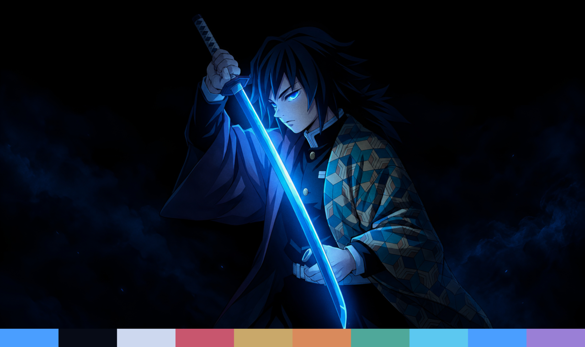

# Omarchy Themes

Themes for [Omarchy](https://omarchy.org/).

| Theme | Preview |
|---|---|
| [Zoro Night](zoro-night/) |  |
| [Giyu Night](giyu-night/) |  |

## Install a theme

Each theme is a folder in this repo. Clone the repo, link the folder into your
themes directory, then apply it:

```bash
git clone https://github.com/Diwanshumidha/omarchy-themes.git ~/Projects/omarchy-themes
ln -s ~/Projects/omarchy-themes/zoro-night ~/.config/omarchy/themes/zoro-night
omarchy theme set zoro-night
```

Run `git pull` in the repo to get updates, then `omarchy theme set zoro-night` again.

## Extras

- [`extras/parallax-background`](extras/parallax-background/): a background plugin
  that gives themes with a `parallax/` folder a two-layer parallax effect.
