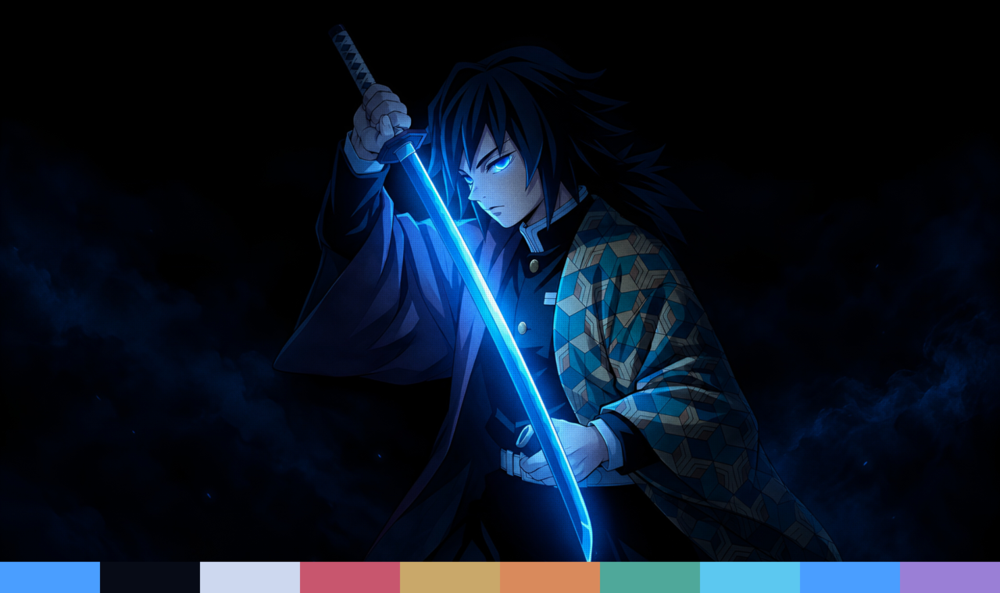

# Giyu Night

A near-black Omarchy theme with electric-blue accents, built around Giyu Tomioka
and his glowing Nichirin blade.

## Palette

| Role | Color | |
|---|---|---|
| Background | `#070b16` | night sky |
| Accent | `#4a9eff` | the blade's glow |
| Foreground | `#cdd8ef` | cool blue-white |
| Green | `#4fa89a` | teal haori panels |
| Yellow | `#c9a86a` | tan haori panels |
| Red | `#c8566e` | wine haori half |

Every app config (terminals, Hyprland, btop, Neovim, VS Code and the rest) is
generated by Omarchy from `colors.toml`. Icons use `Yaru-blue`.

## Wallpaper

`backgrounds/1-giyu-night.png` is cropped to 16:9 and given the same light
halftone-dot and film-grain overlay as [Zoro Night](../zoro-night/).

## Credits

Giyu Tomioka and Demon Slayer: Kimetsu no Yaiba are © Koyoharu Gotouge / Shueisha /
ufotable. The wallpaper is fan art and is not covered by any license in this repo.
