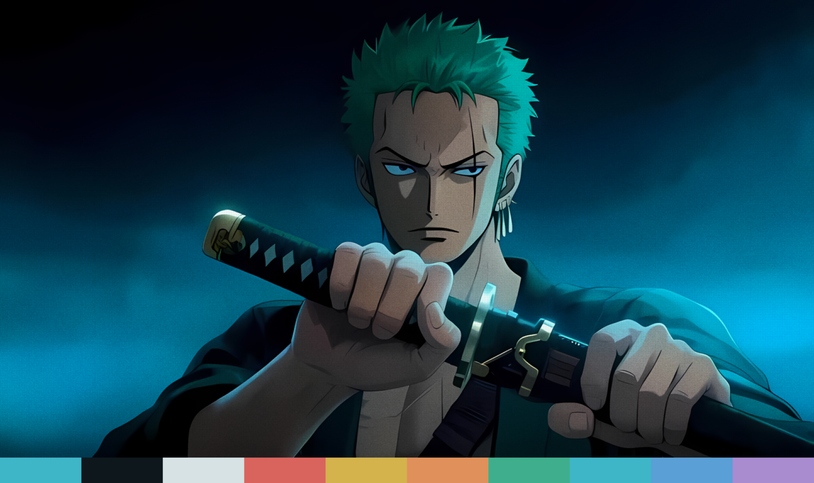

# Zoro Night

A dark navy and teal Omarchy theme built around Roronoa Zoro drawing his sword.

## Palette

| Role | Color | |
|---|---|---|
| Background | `#0e171c` | deep navy |
| Accent | `#3fb5c8` | teal glow |
| Foreground | `#d6e2e4` | cool off-white |
| Green | `#3fae8c` | his hair |
| Yellow | `#d4b24c` | the sword guard |
| Red | `#d9645e` | |

Every app config (terminals, Hyprland, btop, Neovim, VS Code and the rest) is
generated by Omarchy from `colors.toml`. Icons use `Yaru-prussiangreen`.

## Wallpaper

`backgrounds/1-zoro-night.png` is upscaled 4x with Real-ESRGAN
(`realesrgan-x4plus-anime`), then given a light halftone-dot and film-grain overlay.

## Parallax (optional)

`parallax/` holds the wallpaper split into two layers:

- `1-zoro-night.png`: Zoro cut out on a transparent background
- `1-zoro-night.bg.png`: the scene with Zoro removed and the gap filled in

With the [parallax background plugin](../extras/parallax-background/) installed,
Zoro moves more than the scene behind him when you switch workspaces or move the
mouse over an empty desktop. Without the plugin, the regular wallpaper is shown.

## Credits

Roronoa Zoro and One Piece are © Eiichiro Oda / Shueisha / Toei Animation. The
wallpaper is fan art and is not covered by any license in this repo.
